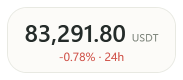

# 比特一瞥 · BitGlance

轻量 Windows 桌面行情小窗：BTC / ETH / SOL 的 USDT 永续价格，可钉在桌面一角。

**Windows 10 / 11 · .NET Framework 4.8 · C# / WPF · AGPL-3.0-only · v1.2.10**




## 功能

- **BTC / ETH / SOL**：USDT 永续最新成交价，可随时切换。
- **多行情源**：设置里切换 **币安**（默认）/ **OKX** / **Bitget**，也可为当前源填写自定义 API 域名（镜像）。无需 API Key。
- **迷你悬浮窗**：始终置顶，可拖动、可缩放；双击价格展开主窗口。可隐藏单位与 24 小时涨跌幅；新安装默认开启「迷你窗显示 K 线」紧凑浮窗。
- **三条均线 + 超级趋势**：K 线叠加 EMA（默认 **7 / 20 / 50**）与经典 SuperTrend（ATR **10** × **3.0**）；左上角图例显示最新数值；迷你窗「设置 · 指标」可改。
- **折线 / K 线**：24H / 7D 折线；1m / 5m / 15m / 1h K 线、右侧价格轴、底部成交量条、图内 HH:mm 时间轴、滚轮缩放、可见高低点、平移与悬停详情；视口右侧留白，最新一根可停在图中间。
- **背景不透明度 0%–100%**：独立于文字；0% 仍保留极薄点击层，避免点数字空隙穿透。
- **明暗主题与托盘**：主窗口可置顶；主窗口和迷你窗分别记住位置。
- **无账号、无交易**：只读公开行情，设置保存在本机。

## 下载与运行

从本仓库克隆或复制后，在 Windows 上按下方「从源码构建」生成 `BitGlance.exe`；也可直接使用已编译好的安装目录（例如本机 `C:\BitGlance`）。

需要 Windows 10 / 11 和 [.NET Framework 4.8](https://dotnet.microsoft.com/download/dotnet-framework/net48)。无需安装程序，也不需要 Node、Rust 或 Python。

| 操作 | 方法 |
| --- | --- |
| 进入迷你窗 | 双击主窗口大价格，或 `Ctrl+M` |
| 展开主窗口 | 双击迷你窗，或在迷你窗按 `Esc` |
| 移动迷你窗 | 按住标题 / 数字区域拖动 |
| 缩放迷你窗 | 拖右下角调整大小 |
| 指标设置 | 迷你窗「设置 · 指标」或仅价格迷你窗右上角「指标」 |
| 切换币种 / 行情源 | 主窗口设置，或迷你窗右键菜单 |
| 缩放 / 查看历史 | K 线区域滚轮缩放、按住左键拖动 |
| 回到最新 K 线 | 点击「最新 →」 |
| 立即刷新 | `F5` 或刷新按钮 |
| 隐藏 / 恢复 | 「—」进托盘，双击托盘图标恢复 |

更多操作见 [使用说明](使用说明.md)。

## 行情与本机数据

默认走 **币安 USDT-M 永续**（公开 ticker / kline；默认 API 基址可在设置里改）。也可切到 OKX SWAP 或 Bitget `USDT-FUTURES`。显示的是永续最新成交价；按设置间隔轮询，未收盘 K 线会继续变。

偏好文件：`%LOCALAPPDATA%\BitGlance\settings.json`。无交易、无遥测、无自动更新、无开机自启。断线时保留最后成功价格并提示；不同交易所价格可能不一致。

## 从源码构建

在 Windows PowerShell 进入仓库目录：

```powershell
powershell -NoProfile -ExecutionPolicy Bypass -File .\source\build.ps1
```

输出在 `artifacts/build/`。使用系统自带的 `csc.exe`，无需 Visual Studio、NuGet 或联网恢复依赖。

一键构建、自检并打发布包：

```powershell
powershell -NoProfile -ExecutionPolicy Bypass -File .\source\package.ps1
```

输出在 `artifacts/release/`（含 ZIP 与 SHA-256）。交互测试需要可交互桌面，见 [开发与验证](CONTRIBUTING.md)。

## 项目结构

```text
.github/           Issue 与 PR 模板
docs/              预览图、发布指引、Release 文案
legal/             保留的 PayDance 法律文件
source/            C# / WPF 源码、资源、构建和测试脚本
LICENSE            AGPL-3.0-only 正文
THIRD_PARTY_NOTICES.md  引用来源与修改说明
```

生成的 EXE、ZIP、测试文件和个人设置由 `.gitignore` 排除（仓库若附带预览图或示例二进制，以实际树为准）。

## 来源与许可

BitGlance 参考 [PayDance](https://github.com/MrBaoboer/PayDance) 的桌面交互，并将其窗口位置校验与屏幕内恢复逻辑移植为 C#。本项目是独立的修改与移植版本，**非 PayDance 官方产品**。

> Based on PayDance. Copyright (C) 2026 Mr.Baoboer.
> Licensed under the GNU Affero General Public License v3.0 only.

代码使用 [AGPL-3.0-only](LICENSE)，保留 [上游附加条款](legal/ADDITIONAL_TERMS.md)。图标和产品预览图来自 BitGlance，未沿用 PayDance 官方品牌素材。来源与修改范围见 [第三方声明](THIRD_PARTY_NOTICES.md)。

本仓库维护地址：[kim1232aa/BitGlance](https://github.com/kim1232aa/BitGlance)

[更新记录](CHANGELOG.md) · [验证记录](验证记录.md) · [使用说明](使用说明.md)
